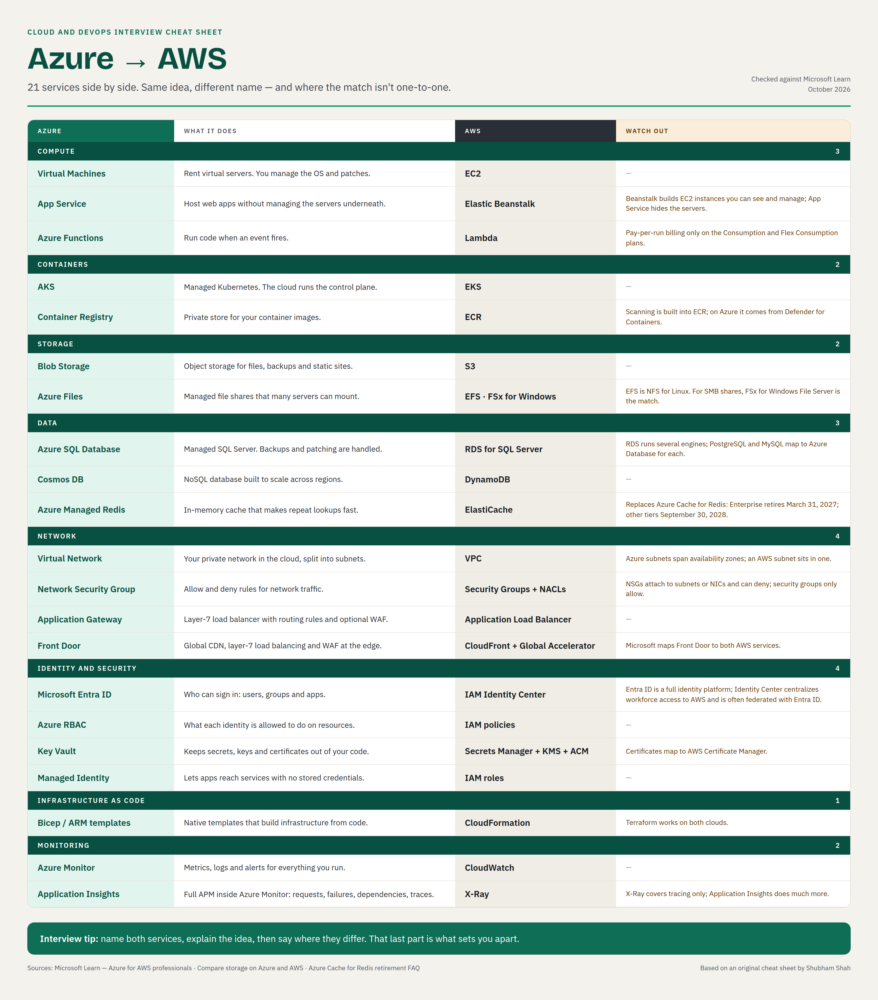

# Azure to AWS Service Cheat Sheet

**Applies to:** Microsoft Azure and Amazon Web Services (AWS) 
**Scope:** Compare 21 common services for technician orientation and interview preparation; mappings describe similar capabilities rather than feature parity. 
**Last Updated:** October 2026

Use the tables below to identify a comparable service, then check the implementation differences before selecting a design. The comparison covers compute, containers, storage, data, networking, identity, infrastructure as code, and monitoring.

> Reviewed against Microsoft Learn and official AWS documentation on October 13, 2026. The supplied draft and infographic credit an original cheat sheet by Shubham Shah; that attribution is retained, but the original publication was not supplied or independently verified.

## Companion Infographic

**Image review:** The supplied PNG is preserved as an original snapshot. Its Functions billing, registry scanning, SQL database, Front Door, and Application Insights rows are simplified; use the corrected tables below for those qualifications. The current AWS instrumentation note is also absent from the image. The image's review date is part of the supplied artwork, not proof of feature parity.

**Interview tip:** name both services, explain the idea, then say where they differ. That last part is what sets you apart.

## Contents

- [Compute](#compute)
- [Containers](#containers)
- [Storage](#storage)
- [Data](#data)
- [Network](#network)
- [Identity and security](#identity-and-security)
- [Infrastructure as code](#infrastructure-as-code)
- [Monitoring](#monitoring)
- [Using this reference in an MSP environment](#using-this-reference-in-an-msp-environment)
- [Verification checklist](#verification-checklist)
- [Sources](#sources)

## Compute

| Azure | What it does | AWS | Watch out |
| --- | --- | --- | --- |
| Virtual Machines | Rent virtual servers. You manage the OS and patches. | EC2 | — |
| App Service | Host web apps without managing the servers underneath. | Elastic Beanstalk | Beanstalk builds EC2 instances you can see and manage; App Service hides the servers. |
| Azure Functions | Execute event-driven code. | Lambda | Hosting plan controls billing and scaling. Consumption/Flex charge for execution and resource usage; Flex always-ready instances add baseline charges. Premium/Dedicated differ, and Container Apps is another hosting option. |

## Containers

| Azure | What it does | AWS | Watch out |
| --- | --- | --- | --- |
| AKS | Managed Kubernetes. The cloud runs the control plane. | EKS | — |
| Azure Container Registry | Store and distribute container images. | ECR | ECR basic scanning covers OS packages; enhanced scanning uses Amazon Inspector and adds language packages and continuous scanning. ACR assessment uses Defender for Containers or supported Defender CSPM scenarios. Enable the required configuration and budget for the security plan. |

## Storage

| Azure | What it does | AWS | Watch out |
| --- | --- | --- | --- |
| Blob Storage | Object storage for files, backups and static sites. | S3 | — |
| Azure Files | Managed file shares that many servers can mount. | EFS · FSx for Windows File Server | EFS is NFS for Linux. For SMB shares, FSx for Windows File Server is the match. |

## Data

| Azure | What it does | AWS | Watch out |
| --- | --- | --- | --- |
| Azure SQL Database | Managed relational database based on the SQL Server engine. | RDS for SQL Server | Broad capability match, not an instance-level equivalent. Check SQL compatibility and instance features; Azure SQL Managed Instance can be a closer fit. Other RDS engines map to other Azure database services. |
| Azure Cosmos DB | Distributed NoSQL database. | DynamoDB | Conceptual match: APIs, query models, partitioning, consistency, and multi-region behavior differ. Validate application compatibility. |
| Azure Managed Redis | In-memory cache that makes repeat lookups fast. | ElastiCache | Replaces Azure Cache for Redis: Enterprise/Enterprise Flash retire March 31, 2027; Basic/Standard/Premium retire September 30, 2028. |

## Network

| Azure | What it does | AWS | Watch out |
| --- | --- | --- | --- |
| Virtual Network | Your private network in the cloud, split into subnets. | VPC | Azure subnets span availability zones; an AWS subnet sits in one. |
| Network Security Group | Allow and deny rules for network traffic. | Security Groups + Network ACLs | NSGs are stateful and support allow/deny rules at subnet/NIC scope. AWS security groups are stateful allow-only controls; network ACLs are stateless subnet controls with allow/deny rules. They are not interchangeable. |
| Application Gateway | Layer-7 load balancer with routing rules and optional WAF. | Application Load Balancer | — |
| Azure Front Door | Global HTTP(S) delivery, routing, and optional WAF at the edge. | CloudFront; Global Accelerator for some acceleration requirements | CloudFront is the closer CDN/HTTP(S) comparison. Global Accelerator uses static anycast IPs for layer-4 TCP/UDP acceleration; it is not a CDN or layer-7 WAF. A combination is architecture-dependent. |

## Identity and security

| Azure | What it does | AWS | Watch out |
| --- | --- | --- | --- |
| Microsoft Entra ID | Who can sign in: users, groups and apps. | IAM Identity Center | Entra ID is a full identity platform; Identity Center centralizes workforce access to AWS and is often federated with Entra ID. |
| Azure RBAC | What each identity is allowed to do on resources. | IAM policies | — |
| Key Vault | Manage secrets, cryptographic keys, and certificates. | Secrets Manager + KMS + ACM | Compare by object type: secrets, keys, or certificates. Certificate issuance, renewal, export, and integration differ; this is a capability grouping, not a single equivalent product. |
| Managed Identity | Lets apps reach services with no stored credentials. | IAM roles | — |

## Infrastructure as code

| Azure | What it does | AWS | Watch out |
| --- | --- | --- | --- |
| Bicep / ARM templates | Native templates that build infrastructure from code. | CloudFormation | Terraform works on both clouds. |

## Monitoring

| Azure | What it does | AWS | Watch out |
| --- | --- | --- | --- |
| Azure Monitor | Metrics, logs and alerts for everything you run. | CloudWatch | — |
| Application Insights | Application performance monitoring within Azure Monitor. | CloudWatch + X-Ray | X-Ray supplies distributed tracing; CloudWatch adds metrics, logs, and application monitoring. Together they are closer to the broader APM scope. Use OpenTelemetry for new X-Ray instrumentation; its SDKs/daemon entered maintenance mode February 25, 2026. |

## Using This Reference in an MSP Environment

No tenant permissions or paid license are needed to read this reference. Deployments require the appropriate Azure subscription/AWS account permissions and separately billed services. Do not assume comparable service names imply matching pricing, SLAs, regions, quotas, identity models, or licensing.

For each customer, record the Azure tenant/subscription and AWS account/region boundaries. Keep workload identity, resource authorization, and workforce federation separate when translating a design. This is a reference rather than a deployment runbook; rollback is not applicable until an implementation is selected.

## Verification Checklist

- [ ] Confirm the mapping against the linked service documentation for the intended workload.
- [ ] Check API/engine/protocol compatibility and required features.
- [ ] Verify regional availability, quotas, network behavior, and access controls.
- [ ] Estimate the chosen SKU/hosting plan and any security or monitoring add-ons.
- [ ] Test migration and recovery in a lab before using the comparison as a design decision.
- [ ] Use the corrected tables rather than the original PNG where they differ.

## Sources

- Microsoft Learn: [Azure for AWS professionals](https://learn.microsoft.com/en-us/azure/architecture/aws-professional/).
- Microsoft Learn: [Compute comparison](https://learn.microsoft.com/en-us/azure/architecture/aws-professional/compute).
- Microsoft Learn: [Storage comparison](https://learn.microsoft.com/en-us/azure/architecture/aws-professional/storage).
- Microsoft Learn: [Database comparison](https://learn.microsoft.com/en-us/azure/architecture/aws-professional/databases).
- Microsoft Learn: [Networking comparison](https://learn.microsoft.com/en-us/azure/architecture/aws-professional/networking).
- Microsoft Learn: [Functions hosting options](https://learn.microsoft.com/en-us/azure/azure-functions/functions-scale) and [consumption-based costs](https://learn.microsoft.com/en-us/azure/azure-functions/functions-consumption-costs).
- Microsoft Learn: [Container vulnerability assessment](https://learn.microsoft.com/en-us/azure/defender-for-cloud/agentless-vulnerability-assessment-azure).
- Microsoft Learn: [Azure SQL Database overview](https://learn.microsoft.com/en-us/azure/azure-sql/database/sql-database-paas-overview?view=azuresql).
- Microsoft Learn: [Identity management comparison](https://learn.microsoft.com/en-us/azure/architecture/aws-professional/security-identity).
- Microsoft Learn: [Redis retirement FAQ](https://learn.microsoft.com/en-us/azure/azure-cache-for-redis/retirement-faq).
- AWS: [Elastic Beanstalk concepts](https://docs.aws.amazon.com/elasticbeanstalk/latest/dg/concepts.html).
- AWS: [ECR image scanning](https://docs.aws.amazon.com/AmazonECR/latest/userguide/image-scanning.html) and [enhanced scanning](https://docs.aws.amazon.com/AmazonECR/latest/userguide/image-scanning-enhanced.html).
- AWS: [Security groups](https://docs.aws.amazon.com/vpc/latest/userguide/vpc-security-groups.html) and [network ACLs](https://docs.aws.amazon.com/vpc/latest/userguide/vpc-network-acls.html).
- AWS: [Global Accelerator](https://docs.aws.amazon.com/global-accelerator/latest/dg/what-is-global-accelerator.html).
- AWS: [RDS for SQL Server](https://docs.aws.amazon.com/AmazonRDS/latest/UserGuide/CHAP_SQLServer.html).
- AWS: [X-Ray SDK and daemon support timeline](https://docs.aws.amazon.com/xray/latest/devguide/xray-sdk-daemon-timeline.html).
