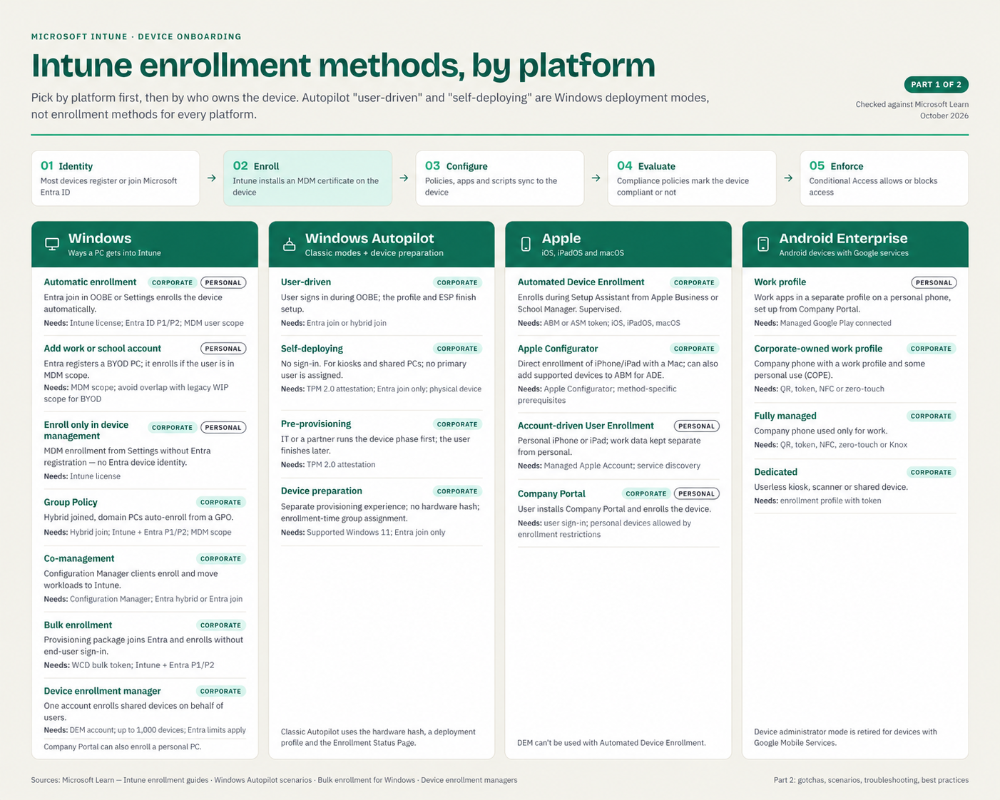
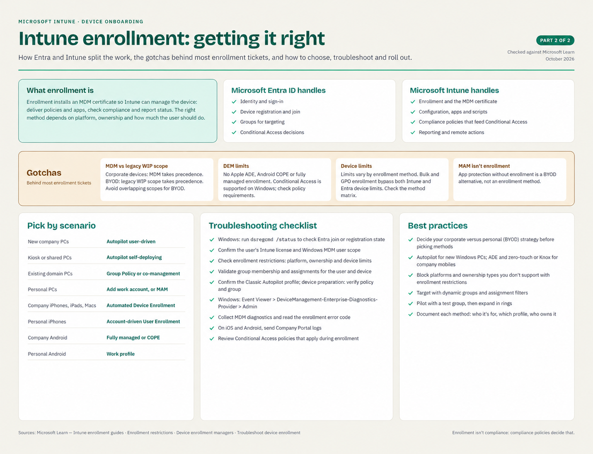

# Intune Enrollment Methods Guide

**Applies to:** Microsoft Intune; Windows, iOS/iPadOS, macOS, and Android Enterprise 
**Scope:** Select enrollment methods by platform and ownership, prepare prerequisites, and verify a pilot deployment 
**Last Updated:** October 10, 2026

Choose by platform first, then by who owns the device. Autopilot "user-driven" and "self-deploying" are Windows deployment modes, not enrollment methods that apply to every platform.

> The two infographics summarize the choices. Read the qualifications and prerequisites below before deployment. Select the customer tenant in **Intune admin center > Devices > Device onboarding > Enrollment**; labels can vary as portal changes roll out.

## Prerequisites

| Requirement | Detail |
|---|---|
| Licensing | Intune entitlement for enrolled users, or eligible device-only licensing for supported userless scenarios; Windows automatic enrollment also requires Entra ID P1/P2. Conditional Access requires appropriate Entra licensing. |
| Permissions | Appropriate Intune RBAC permissions and scope tags for enrollment profiles and restrictions; Microsoft documents Global Administrator for configuring Windows automatic enrollment. Use elevated roles only for the required setup. |
| Windows | Supported edition/build, intended Entra join type, automatic enrollment scope, and Autopilot prerequisites where used. |
| Apple | Apple MDM push certificate; ADE additionally needs an ABM/ASM enrollment program token and assigned devices. Account-driven User Enrollment needs Managed Apple Accounts and service discovery. |
| Android Enterprise | Managed Google Play connection, supported GMS devices, and an enrollment profile/token for corporate enrollment. |
| Recovery | Preserve user data and recovery keys before resetting a device; confirm a tested recovery path and local administrator access. |

**MSP note:** Verify tenant selection, token ownership/expiry, licenses, scope tags, and assignments for each customer. Avoid reusing enrollment tokens or Apple/Google connectors between tenants. Never place customer identifiers or collected device logs in this repository.

## Contents

- [What enrollment is](#what-enrollment-is)
- [How enrollment works](#how-enrollment-works)
- [Windows](#windows)
- [Windows Autopilot deployment modes](#windows-autopilot-deployment-modes)
- [Apple (iOS, iPadOS, macOS)](#apple-ios-ipados-macos)
- [Android Enterprise](#android-enterprise)
- [Gotchas](#gotchas)
- [Pick by scenario](#pick-by-scenario)
- [Troubleshooting checklist](#troubleshooting-checklist)
- [Pilot Verification](#1-pilot-verification)
- [Rollback and Recovery](#2-rollback-and-recovery)
- [Best practices](#best-practices)
- [Sources](#sources)

## What enrollment is

Enrollment installs an MDM certificate on a device so Intune can manage it: deliver policies and apps, check compliance, and report status. The right method depends on the platform, who owns the device, and how much the user should have to do.

| Microsoft Entra ID handles | Microsoft Intune handles |
| --- | --- |
| Identity and sign-in | Enrollment and the MDM certificate |
| Device registration and join | Configuration, apps and scripts |
| Groups for targeting | Compliance policies that feed Conditional Access |
| Conditional Access decisions | Reporting and remote actions |

## How enrollment works

1. **Identity.** Most devices register or join Microsoft Entra ID.
2. **Enroll.** Intune installs an MDM certificate on the device.
3. **Configure.** Policies, apps and scripts sync to the device.
4. **Evaluate.** Compliance policies mark the device compliant or not compliant.
5. **Enforce.** Conditional Access allows or blocks access.

Enrollment doesn't make a device compliant. Compliance policies decide that.

## Windows

| Method | Ownership | What it does | Needs |
| --- | --- | --- | --- |
| Automatic enrollment | Corporate or personal | Entra join in OOBE or Settings enrolls the device automatically. | Intune license; user in MDM scope; Entra ID P1/P2 |
| Add work or school account | Personal | Entra registers a BYOD PC; it enrolls if the user is in MDM scope. | Intune license; MDM scope; avoid legacy WIP scope overlap for BYOD |
| Enroll only in device management | Corporate or personal | MDM enrollment from Settings without Entra registration, so there's no Entra device identity. | Intune license |
| Group Policy | Corporate | Hybrid joined, domain PCs auto-enroll from a GPO. | Entra hybrid join; Intune and Entra ID P1/P2; MDM scope |
| Co-management | Corporate | Configuration Manager clients enroll and move workloads to Intune. | Configuration Manager; Entra hybrid or Entra join |
| Bulk enrollment | Corporate | A Windows Configuration Designer provisioning package joins Entra and enrolls without end-user sign-in. | Authorized bulk-token account in MDM scope; Intune and Entra ID P1/P2 |
| Device enrollment manager (DEM) | Corporate | One account enrolls shared devices on behalf of users. | Designated DEM account; up to 1,000 devices, subject to applicable Entra limits |

Company Portal can also enroll a personal PC.

## Windows Autopilot deployment modes

User-driven, self-deploying, and pre-provisioning are classic Windows Autopilot deployment experiences. Windows Autopilot device preparation is a separate provisioning experience, included here for comparison.

| Mode | What it does | Needs |
| --- | --- | --- |
| User-driven | The user signs in during OOBE; the profile and the Enrollment Status Page finish setup. | Entra join or Entra hybrid join |
| Self-deploying | No sign-in. For kiosks and shared PCs; no primary user is assigned. | TPM 2.0 with attestation; Entra join only; physical device (no VMs) |
| Pre-provisioning | IT or a partner runs the device phase first; the user finishes later. | TPM 2.0 with attestation |
| Device preparation | Separate provisioning experience; no hardware hash; enrollment-time device group assignment. | Supported Windows 11; Entra join only; device preparation policy and enrollment-time group |

Classic Autopilot uses the hardware hash, a deployment profile and the Enrollment Status Page.

## Apple (iOS, iPadOS, macOS)

| Method | Ownership | What it does | Needs |
| --- | --- | --- | --- |
| Automated Device Enrollment (ADE) | Corporate | Enrolls during Setup Assistant from Apple Business Manager or Apple School Manager. Devices are supervised. | ABM or ASM token |
| Apple Configurator | Corporate | Direct iPhone/iPad enrollment using a Mac, or adding supported devices to ABM for subsequent ADE; these are different workflows. | Apple Configurator and workflow-specific prerequisites |
| Account-driven User Enrollment | Personal | For personal iPhones and iPads; keeps work data separate from personal data. | Managed Apple Account; service discovery |
| Company Portal | Corporate or personal | The user installs Company Portal and enrolls the device. | User sign-in; personal devices allowed by enrollment restrictions |

DEM can't be used with Automated Device Enrollment.

## Android Enterprise

| Method | Ownership | What it does | Needs |
| --- | --- | --- | --- |
| Work profile | Personal | Separate work profile on a personal phone; Company Portal or supported web-based enrollment, depending on tenant rollout. | Managed Google Play connected |
| Corporate-owned work profile (COPE) | Corporate | Company phone with a work profile and some personal use. | QR code, token, NFC or zero-touch |
| Fully managed | Corporate | Company phone used only for work. | QR code, token, NFC, zero-touch or Knox Mobile Enrollment |
| Dedicated | Corporate | Userless kiosk, scanner or shared device. | Enrollment profile with token |

Device administrator mode is retired for devices with Google Mobile Services.

## Gotchas

- **MDM vs legacy WIP scope.** Microsoft now labels the legacy scope WIP in its automatic enrollment guidance. With overlapping scopes, MDM takes precedence on corporate devices; WIP takes precedence on BYOD and prevents automatic MDM enrollment. Avoid overlap for BYOD. This legacy scope is separate from modern Windows MAM/app protection.
- **DEM limits.** DEM is not supported for Apple ADE or Android Enterprise corporate-owned work profile, fully managed, or dedicated enrollment. Conditional Access is supported on DEM-enrolled Windows 10 version 1803 and later and Windows 11; evaluate actual policy requirements rather than excluding DEM accounts by default.
- **Device limits.** Limits depend on the enrollment path. Intune limits are bypassed by several automatic methods; Entra limits apply only where supported. Bulk and Group Policy enrollment bypass both. Use the matrix below instead of assuming an Entra cap covers every device.

| Windows enrollment path | Intune per-user limit | Entra per-user limit |
|---|---|---|
| BYOD user enrollment | Yes | Yes |
| Group Policy / hybrid join | No | No |
| DEM automatic enrollment | No | Yes |
| Bulk provisioning package | No | No |
| Autopilot with user affinity | No | Yes |
| Co-management | No | Where supported by join type; hybrid join is excluded |

Automatic enrollment initiated through Windows Settings can also bypass the Intune cap. Consult the linked method matrix for the exact flow. Userless deployments have different device identity and user-affinity behavior.

- **MAM isn't enrollment.** App protection without enrollment is an alternative for BYOD, not an enrollment method.

## Pick by scenario

| Scenario | Method |
| --- | --- |
| New company PCs | Autopilot user-driven |
| Kiosk or shared PCs | Autopilot self-deploying |
| Existing domain PCs | Group Policy or co-management |
| Personal PCs | Add work or school account, or MAM |
| Company iPhones, iPads and Macs | Automated Device Enrollment |
| Personal iPhones | Account-driven User Enrollment |
| Company Android | Fully managed or COPE |
| Personal Android | Work profile |

## Troubleshooting checklist

- [ ] On Windows, run `dsregcmd /status` to check Entra join or registration state.
- [ ] Confirm the user's Intune license and Windows MDM user scope.
- [ ] Check enrollment restrictions: platform, ownership and device limits.
- [ ] Validate group membership and assignments for the user and the device.
- [ ] For classic Autopilot, confirm profile assignment before OOBE; for device preparation, verify the policy, enrollment-time group, and required group owner.
- [ ] On Windows, check **Event Viewer > Applications and Services Logs > Microsoft > Windows > DeviceManagement-Enterprise-Diagnostics-Provider > Admin**.
- [ ] Collect MDM diagnostics and read the enrollment error code.
- [ ] On iOS and Android, send Company Portal logs.
- [ ] Review Conditional Access policies that apply during enrollment.

## 1. Pilot Verification

1. Enroll a test device using the selected path and confirm its record under **Intune admin center > Devices > All devices**.
2. Verify ownership, serial number, join/registration state, primary user or expected userless behavior, and recent check-in.
3. Confirm a pilot configuration and application arrive, then verify compliance evaluation separately.
4. Test an intended resource with Conditional Access and review sign-in logs; do not treat enrollment alone as proof of compliance.
5. Open both infographics in the GitHub article after publication and confirm they display without broken-image placeholders.

## 2. Rollback and Recovery

1. Record the original enrollment scopes, restriction assignments, profiles, and affected pilot devices before changes.
2. Stop expanding the pilot and restore prior assignments/settings if onboarding fails. Restoring scope settings does not automatically unenroll existing devices.
3. Review the platform's Retire, Delete, and Wipe behavior before taking a remote action. A Wipe can remove personal and corporate data; choose the action that matches ownership and the recovery plan.
4. For corporate devices requiring a reset, preserve data and recovery keys and confirm the intended enrollment profile before reprovisioning. For BYOD, use the approved work-data removal process.
5. Retain shared Apple/Google connectors and tokens while they still serve managed devices; do not remove them as a routine pilot rollback.

## Best practices

- Decide your corporate versus personal (BYOD) strategy before choosing methods.
- Use Autopilot for new Windows PCs, and ADE, zero-touch or Knox for company mobile devices.
- Block platforms and ownership types you don't support with enrollment restrictions.
- Target with dynamic groups and assignment filters.
- Pilot with a test group, then expand in rings.
- Document each method: who it's for, which profile it uses, and who owns it.

## Sources

- Microsoft Learn: [Device enrollment guide for Microsoft Intune](https://learn.microsoft.com/en-us/intune/device-enrollment/guide)
- Microsoft Learn: [Windows device enrollment guide](https://learn.microsoft.com/en-us/intune/device-enrollment/windows/guide)
- Microsoft Learn: [Windows Autopilot scenarios](https://learn.microsoft.com/en-us/autopilot/tutorial/autopilot-scenarios)
- Microsoft Learn: [Bulk enrollment for Windows devices](https://learn.microsoft.com/en-us/intune/device-enrollment/windows/create-bulk-package)
- Microsoft Learn: [Enroll devices using a device enrollment manager account](https://learn.microsoft.com/en-us/intune/device-enrollment/setup-enrollment-manager)
- Microsoft Learn: [Overview of enrollment restrictions](https://learn.microsoft.com/en-us/intune/device-enrollment/restrictions)
- Microsoft Learn: [Troubleshoot device enrollment in Intune](https://learn.microsoft.com/en-us/troubleshoot/mem/intune/device-enrollment/troubleshoot-device-enrollment-in-intune)

- Microsoft Learn: [Windows automatic enrollment and scope precedence](https://learn.microsoft.com/en-us/intune/device-enrollment/windows/enable-automatic-mdm)
- Microsoft Learn: [Intune and Entra device limit matrix](https://learn.microsoft.com/en-us/intune/device-enrollment/limits-intune-entra)
- Microsoft Learn: [Windows Autopilot device preparation](https://learn.microsoft.com/en-us/autopilot/device-preparation/overview)
- Microsoft Learn: [Android enrollment guide](https://learn.microsoft.com/en-us/intune/device-enrollment/android/guide)
- Microsoft Learn: [iOS/iPadOS enrollment guide](https://learn.microsoft.com/en-us/intune/device-enrollment/apple/guide-ios-ipados)
- Microsoft Learn: [Apple Configurator enrollment](https://learn.microsoft.com/en-us/intune/device-enrollment/apple/setup-configurator-ios)
- Microsoft Learn: [Apple User Enrollment methods](https://learn.microsoft.com/en-us/intune/device-enrollment/apple/user-enrollment-methods-ios)
