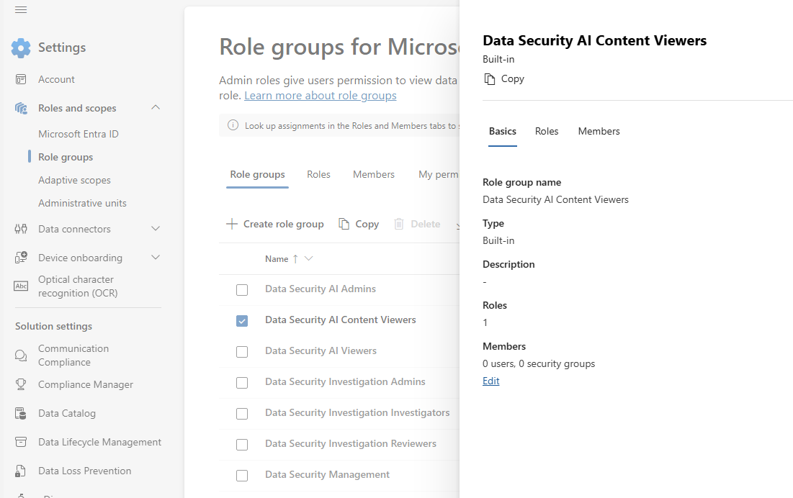
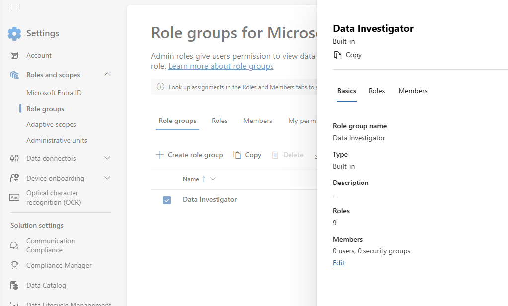
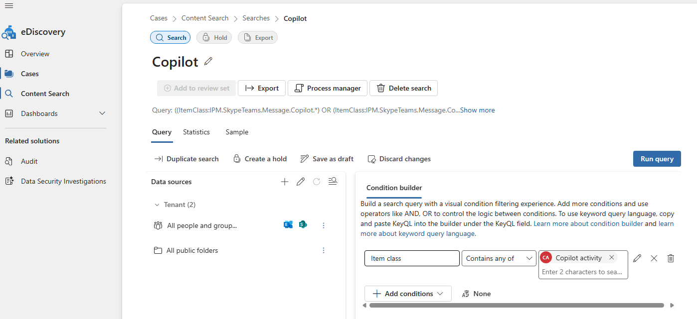
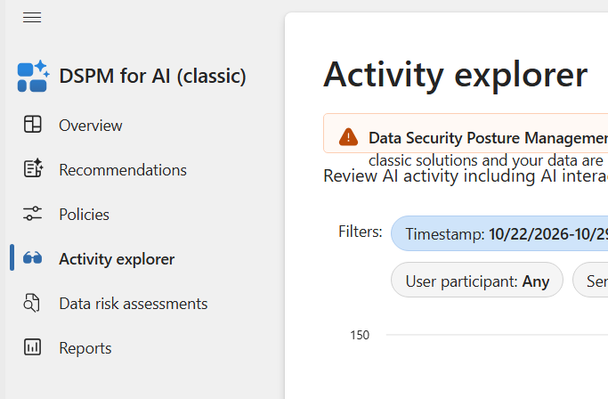

# Microsoft Copilot Prompt Investigation Guide

**Applies to:** Microsoft Purview in Microsoft 365 Business Premium tenants; Microsoft Purview Suite for Business Premium where specified  
**Scope:** Locate stored Copilot prompts and responses, inspect AI activity, and configure scoped compliance investigations  
**Last Updated:** November 2026

## Overview

For a known user's stored Copilot conversation, start at **Microsoft Purview > Solutions > eDiscovery > Content Search**. For recent AI activity, use **Solutions > DSPM > Discover > Activity explorer > AI activities**. Use Communication Compliance for policy matches and Insider Risk Management for risk investigations.

These views answer different questions. A website visit does not prove prompt capture, and a risk alert is not a complete conversation history. Missing results can reflect collection settings, permissions, indexing, retention, or the selected workload.

## Minimum Licensing for Business Premium Tenants

Here, **Business Premium** means **Microsoft 365 Business Premium**, not eDiscovery (Premium) or Audit (Premium). The table identifies the minimum relevant licensing path within a Business Premium deployment; it does not compare every enterprise SKU.

| Workflow | Business Premium alone | Add-on or additional requirement |
|---|---|---|
| Basic eDiscovery search and export of retained, supported Copilot items | Includes eDiscovery (Standard); no Purview Suite add-on required for the standard workflow | The user must have access to the Copilot experience that produced the records. Paid Microsoft 365 Copilot functionality requires its own Copilot license. |
| eDiscovery premium review sets and advanced analysis | No | **Microsoft Purview Suite for Business Premium**, or the combined **Microsoft Defender and Purview Suites for Business Premium** |
| DSPM AI activity investigation | Do not assume the base license covers all DSPM capabilities | Use the **Purview Suite for Business Premium** path for the advanced Purview workloads. Confirm the selected DSPM scenario's entitlement and availability before quoting; underlying collection, endpoint, AI workload, and billing prerequisites still apply. |
| Communication Compliance policies and review | No | **Microsoft Purview Suite for Business Premium**, or the combined suite; separately license the applicable Copilot experience |
| Insider Risk Management policies and investigation | No | **Microsoft Purview Suite for Business Premium**, or the combined suite; selected indicators can require additional telemetry or service configuration |
| Audit (Standard) activity records | Yes | No Purview Suite add-on for standard auditing; this does not provide a transcript of every prompt |

Microsoft's [Purview licensing guidance](https://www.microsoft.com/licensing/guidance/Microsoft-Purview) lists Business Premium's core capabilities and the Business Premium add-on route. The [SMB security suite comparison](https://www.microsoft.com/licensing/guidance/Security-Suites) identifies the services included in each suite.

**Which suite should an MSP quote?** For Communication Compliance, Insider Risk Management, and premium eDiscovery, add **Microsoft Purview Suite for Business Premium**. Choose the combined **Microsoft Defender and Purview Suites for Business Premium** when the customer also needs the Defender upgrades. **Microsoft Defender Suite for Business Premium alone does not include those advanced Purview services.** Use the Business Premium-specific SKU rather than assuming an enterprise add-on has the same prerequisites.

The [Purview Suite for Business Premium product page](https://www.microsoft.com/en-us/security/small-medium-business/microsoft-purview-suite-business-premium) specifies the Business Premium prerequisite and maximum of 300 seats. License the users benefiting from the service, including applicable administrators and investigated users; buying one add-on seat does not license tenant-wide monitoring. See the [Purview service description](https://learn.microsoft.com/en-us/office365/servicedescriptions/microsoft-365-service-descriptions/microsoft-365-tenantlevel-services-licensing-guidance/microsoft-purview-service-description).

**Copilot and usage billing are separate.** A Purview add-on does not grant paid Microsoft 365 Copilot use. Business Premium includes access to eligible Microsoft 365 Copilot Chat experiences, but that is not the same entitlement as paid Microsoft 365 Copilot. For the paid experience in a Business Premium deployment, evaluate the **Microsoft Copilot Business** add-on. Check the actual app and user license rather than treating every product named Copilot alike. [Copilot license options](https://learn.microsoft.com/en-us/copilot/plan/copilot-license-options)

For Communication Compliance, Microsoft states that detecting risky Microsoft 365 Copilot interactions has no pay-as-you-go charge. Non-Microsoft 365 AI data requires pay-as-you-go billing, including some Microsoft products such as Security Copilot, Fabric Copilot, and Copilot Studio. Collection and other metered capabilities can have their own charges. Review the selected scenario and Azure billing configuration before enabling it; do not describe the suite as including unlimited third-party AI capture. [Communication Compliance billing](https://learn.microsoft.com/en-us/purview/communication-compliance-configure)

## Prerequisites

| Requirement | What to verify |
|---|---|
| Customer tenant | Sign in to [Microsoft Purview](https://purview.microsoft.com) in the intended customer's directory. Record the approved users, dates, workloads, and investigation purpose in the customer's ticket. |
| Licenses | Assign the base and required add-on licenses for the chosen workflow. Verify the Copilot app's entitlement separately. |
| Data | Confirm the user has an Exchange Online mailbox for stored Microsoft 365 Copilot interactions. Check retention and whether records still exist. |
| Auditing and collection | Verify auditing is enabled. For other AI apps, verify the required connector, browser integration, and content collection policy. |
| Permissions | Assign workflow-specific roles from section 1 and confirm case or policy reviewer membership. |
| Pilot | Use an approved test account and a harmless, unique prompt such as `Explain the phrase PURVIEW-LAB-CHECK-001 in one sentence.` Record the app, account, time, and time zone. |

## 1. Assign Workflow-Specific Permissions

Use **Purview > Settings > Roles and scopes > Role groups**. Have an authorized role administrator add only the approved personnel, save the change, and allow permissions to propagate before retesting.

| Task | Role assignment |
|---|---|
| Create an eDiscovery case and search | **eDiscovery Manager**, with membership in the relevant case. Use a custom role group if narrower search-only duties are required. |
| View DSPM AI activity | **Data Security AI Viewers** for AI activity visibility; add **Data Security AI Content Viewers** for prompt and response text. |
| Configure DSPM setup tasks | Use an authorized **Compliance Administrator**; individual setup tasks can require additional solution permissions. Do not give routine reviewers this role solely to read prompts. |
| Configure Communication Compliance | **Communication Compliance Admins** |
| Review Communication Compliance matches | **Communication Compliance Analysts** or **Communication Compliance Investigators**, plus assignment in that policy's **Reviewers** field |
| Configure Insider Risk Management | **Insider Risk Management Admins** |
| Investigate insider risk alerts and cases | **Insider Risk Management Analysts** or **Insider Risk Management Investigators**; content explorer access requires the investigator permissions |

DSPM permissions for AI website visits and user risk information can additionally require Insider Risk Management analyst or investigator access. General dashboard access does not automatically grant AI content access. [DSPM permission matrix](https://learn.microsoft.com/en-us/purview/data-security-posture-management-permissions)

*Role-group navigation reference from the supplied draft. Membership and role counts vary by tenant.*

**Avoid broad grants for this task.** The **Data Investigator** group includes **Search And Purge**. Searching and reviewing prompts does not require granting purge permissions. The following image identifies the broad group for comparison; it is not the assignment recommended by this guide. [Purview roles](https://learn.microsoft.com/en-us/defender-office-365/scc-permissions)

**MSP note:** Verify effective access inside each customer tenant. A partner relationship or an Entra administrative role alone does not establish all Purview case, content, or reviewer permissions. Keep case membership and exported evidence separated by customer. Administrative-unit restrictions can also limit visible users and results.

## 2. Find Stored Prompts with eDiscovery

1. Open **Purview > Solutions > eDiscovery > Content Search** and create a search. For a formal investigation, use **Cases > New case**, assign the investigators, and create a search within that case.
2. In **Query > Data sources**, select the relevant users and their **Exchange Online mailboxes**. Avoid a tenant-wide selection for a single-user investigation.
3. Set **Item class > Contains any of > Copilot activity** in the condition builder.
4. Add a date range around the recorded test time. For a pilot, add the unique test phrase as a keyword. Confirm the date/time interpretation used by the portal.
5. Select **Run query** and wait for processing. Review **Statistics**, then **Sample** or the available result-viewing option. A sample is not the full result set.
6. Use the authorized export workflow when all results are required. Keep exports in the customer's restricted evidence location. Premium review sets require the add-on in the licensing table.
7. Verify the expected account, app, prompt text, response, and timestamp. Record which record types and locations were searched.

*The supplied screenshot demonstrates the filter. Its broad data-source selection is not the recommended pilot scope.*

The **Copilot activity** selection can cover other supported AI application items as well as Microsoft 365 Copilot. Results depend on retained and searchable content; they are not a guarantee that every historical interaction exists. Microsoft documents stored interaction items in the user's mailbox and explains their sender/recipient fields in [Search for AI application data](https://learn.microsoft.com/en-us/purview/edisc-search-copilot-data). That source also covers deletion, which is outside this guide's workflow.

## 3. Inspect AI Activity in Current DSPM

1. Open **Purview > Solutions > DSPM**. Select the current **DSPM** experience.
2. Review **Setup tasks**. Record which prerequisites are complete and which changes are proposed before activating collection or policies.
3. Open **Discover > Activity explorer > AI activities**.
4. Filter by time, user, application, and activity type to locate the pilot interaction.
5. Open an **AI interaction** event and inspect the available content. Compare it with **AI website visit** events, which establish a visit rather than a captured conversation.
6. If content is missing, check content-viewer permissions, mailbox availability, capture settings, and adjacent interaction entries before concluding that no prompt exists.

Initial setup can take about a day to populate data. The current path and setup guidance are documented in [Learn about DSPM](https://learn.microsoft.com/en-us/purview/data-security-posture-management-learn-about).

### Third-Party AI and Browser Prerequisites

| Scenario | Required setup to verify |
|---|---|
| Other AI apps in Edge | Activate the Microsoft Purview integration through the required Edge configuration policy. A browser extension alone is not the complete configuration. |
| Endpoint DLP on supported devices | Confirm Endpoint DLP entitlement and Purview device onboarding. Confirm device health and policy delivery. |
| Endpoint DLP in Chrome on Windows | Deploy the Microsoft Purview extension in addition to the required endpoint configuration. |
| Insider risk website-visit signals | Configure the supported browser extension and browsing indicators for the selected scenario. Treat these signals separately from prompt capture. |
| AI content collection outside Microsoft 365 Copilot | Configure the supported connector or browser/network collection route and explicitly enable content capture where required. Confirm billing. |

Use the [browser and device prerequisites](https://learn.microsoft.com/en-us/purview/dspm-for-ai-considerations) and the current [DSPM deployment considerations](https://learn.microsoft.com/en-us/purview/data-security-posture-management-considerations) for the selected route. For unmanaged AI apps in Edge, Microsoft documents text prompts only, not complete prompt-and-response capture. A collection policy without content capture can produce activity without readable content.

### Legacy Navigation Reference

Older tenants or training material may show **DSPM for AI (classic) > Activity explorer**. Microsoft has replaced that experience; use the current workflow above for new deployments. Existing classic one-click policies can require at least 24 hours to populate data after activation or changes. [Classic DSPM documentation](https://learn.microsoft.com/en-us/purview/dspm-for-ai)

*Legacy navigation excerpt only. The source image is cropped and does not show a complete warning, filter set, or event result. Use the written current procedure above.*

## 4. Review Communication Compliance Matches

1. Open **Purview > Solutions > Communication Compliance > Policies**.
2. Select **Create policy > Detect Microsoft Copilot interactions**. Use **Customize policy** to inspect and adjust the settings.
3. Scope the policy to licensed pilot users and the intended AI locations. Select the reviewers explicitly.
4. Review conditions and the review percentage. For a controlled test, use a harmless keyword condition matching the pilot phrase and a 100% review percentage.
5. Save the policy, allow activation, and generate a new test interaction. This policy workflow evaluates activity after activation; it is not a substitute for a historical eDiscovery search.
6. Open the policy and inspect **Pending** matches as an assigned reviewer. Prompts and responses can appear as separate matches; only the matching item may be present.

For an approved broad collection use case, Microsoft documents selecting AI locations, removing conditions, and setting 100% review. Assess review volume and storage before expanding beyond the pilot. [Copilot policy configuration](https://learn.microsoft.com/en-us/purview/communication-compliance-copilot)

## 5. Investigate Risk with Insider Risk Management

1. Open **Purview > Solutions > Insider Risk Management > Settings > Policy indicators**. Enable the indicators required for the intended scenario.
2. Open **Policies > Create policy** and select **Risky AI usage** where available.
3. Scope the policy to licensed pilot users. Configure the triggering events, indicators, and thresholds presented by the wizard.
4. Check the template prerequisites. Microsoft's current template guidance lists supported browser extensions and at least one browsing indicator; optional HR or Communication Compliance integrations have their own setup requirements.
5. Save the policy and validate signal ingestion with an approved lab scenario that meets the chosen trigger and threshold. A harmless prompt alone might not generate a risk alert.
6. Review **Alerts** and the resulting **Cases** using analyst or investigator access. Keep pseudonymization and case handling aligned with the customer's investigation process.

Insider Risk Management correlates signals to identify risk. It does not provide an exhaustive prompt log. See [policy templates](https://learn.microsoft.com/en-us/purview/insider-risk-management-policy-templates), [policy indicators](https://learn.microsoft.com/en-us/purview/insider-risk-management-settings-policy-indicators), and [investigation permissions](https://learn.microsoft.com/en-us/purview/insider-risk-management-permissions).

## Verification / Testing Checklist

- [ ] Confirm the customer tenant, pilot users, license assignments, and selected Copilot workload.
- [ ] Record the test prompt, app, timestamp, and time zone without using customer secrets.
- [ ] Confirm a known retained interaction is searchable in the expected mailbox.
- [ ] Verify DSPM distinguishes a website visit from an AI interaction with available content.
- [ ] Verify a permitted content viewer can read captured text and a dashboard-only reviewer cannot.
- [ ] Confirm the Communication Compliance reviewer can open the pilot match.
- [ ] For insider risk, validate the selected trigger and indicators rather than expecting every prompt to alert.
- [ ] Record ingestion delays, actual coverage, and any missing data in the customer ticket.
- [ ] Check usage/billing for metered collection before expanding scope.
- [ ] Remove temporary access and pilot configuration when testing ends.

## Troubleshooting

| Symptom | Likely cause | Action |
|---|---|---|
| eDiscovery returns no results | Wrong mailbox, dates, query, indexing delay, or expired/deleted content | Search the pilot mailbox and time range first; confirm the app generated a supported record and check retention. |
| DSPM shows events but no text | Missing content permissions, capture disabled, or workload limitation | Check the AI content-viewer role and collection policy; inspect adjacent entries and verify an Exchange Online mailbox exists. |
| Only AI website visits appear | Browsing telemetry is configured without the necessary content collection | Validate the app/browser collection route; a visit is not evidence that a prompt was captured. |
| Communication Compliance policy is visible but matches cannot be reviewed | Missing reviewer membership or investigation role | Check both the role group and that policy's Reviewers field. |
| No insider risk alert | No qualifying trigger, threshold not met, missing indicators, or ingestion delay | Review policy prerequisites and the pilot trigger; do not broaden production monitoring simply to force an alert. |
| Feature missing after purchasing an add-on | Wrong SKU, unassigned license, unsupported region/scenario, or incomplete provisioning | Verify the Business Premium-specific add-on and service plans; confirm scenario availability with Microsoft if unclear. |
| One-click setup is unavailable | Administrative-unit restrictions or missing solution permissions | Have an authorized unrestricted administrator review the task and scope. |

## Rollback and Pilot Cleanup

1. Record the original settings and the names of every pilot policy, reviewer assignment, and role membership before making changes.
2. Restore modified policies to their recorded settings. Pause or disable pilot collection where the solution supports it; review dependencies before deleting a pilot policy.
3. Remove temporary reviewer, case, and role-group assignments. Keep the required permanent administrators in place.
4. Revert browser settings or extensions only when they were deployed solely for this pilot and are not needed by existing protection policies.
5. Confirm metered activity has stopped before removing any pilot-only Azure billing configuration. Do not disconnect billing used by other production workloads.
6. Preserve evidence according to the customer's retention requirements. Stopping collection does not erase previously collected data. Do not remove holds, purge prompts, or delete investigation evidence as routine cleanup.

## Sources

- Microsoft Licensing: [Microsoft Purview licensing guidance](https://www.microsoft.com/licensing/guidance/Microsoft-Purview)
- Microsoft Licensing: [Security suites comparison, including Business Premium add-ons](https://www.microsoft.com/licensing/guidance/Security-Suites)
- Microsoft Security: [Microsoft Purview Suite for Business Premium](https://www.microsoft.com/en-us/security/small-medium-business/microsoft-purview-suite-business-premium)
- Microsoft Learn: [Microsoft Purview service description](https://learn.microsoft.com/en-us/office365/servicedescriptions/microsoft-365-service-descriptions/microsoft-365-tenantlevel-services-licensing-guidance/microsoft-purview-service-description)
- Microsoft Learn: [Purview roles and role groups](https://learn.microsoft.com/en-us/defender-office-365/scc-permissions)
- Microsoft Learn: [Copilot license options](https://learn.microsoft.com/en-us/copilot/plan/copilot-license-options)
- Microsoft Learn: [Search for AI application data in eDiscovery](https://learn.microsoft.com/en-us/purview/edisc-search-copilot-data)
- Microsoft Learn: [Current Data Security Posture Management](https://learn.microsoft.com/en-us/purview/data-security-posture-management-learn-about)
- Microsoft Learn: [DSPM deployment considerations](https://learn.microsoft.com/en-us/purview/data-security-posture-management-considerations)
- Microsoft Learn: [DSPM permissions](https://learn.microsoft.com/en-us/purview/data-security-posture-management-permissions)
- Microsoft Learn: [DSPM for AI classic](https://learn.microsoft.com/en-us/purview/dspm-for-ai)
- Microsoft Learn: [Classic DSPM browser and device prerequisites](https://learn.microsoft.com/en-us/purview/dspm-for-ai-considerations)
- Microsoft Learn: [Communication Compliance for Copilot interactions](https://learn.microsoft.com/en-us/purview/communication-compliance-copilot)
- Microsoft Learn: [Communication Compliance setup and billing](https://learn.microsoft.com/en-us/purview/communication-compliance-configure)
- Microsoft Learn: [Insider Risk Management policy templates](https://learn.microsoft.com/en-us/purview/insider-risk-management-policy-templates)
- Microsoft Learn: [Insider Risk Management policy indicators](https://learn.microsoft.com/en-us/purview/insider-risk-management-settings-policy-indicators)
- Microsoft Learn: [Insider Risk Management permissions](https://learn.microsoft.com/en-us/purview/insider-risk-management-permissions)

**Screenshot provenance:** Images were extracted from the owner's supplied Word draft. The original training-video title and URL were not included; these images are navigation references, not evidence of validation in a customer tenant.
